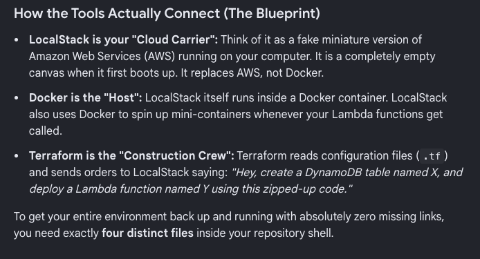

## Architecture

┌──────────────────────┐      Triggers      ┌───────────────────┐      Fetches Data      ┌──────────────────┐
│ Amazon EventBridge   │ ─────────────────> │ Producer Lambda   │ ─────────────────────> │   External API   │
│ (Serverless Cron)    │                    │ (Python/Boto3)    │                        └──────────────────┘
└──────────────────────┘                    └───────────────────┘
│
│ Pushes Messages
▼
┌──────────────────────┐   Auto-Invokes    ┌───────────────────┐
│   Consumer Lambda    │ <──────────────── │    Amazon SQS     │
│ (Saves to DynamoDB)  │                   │ (Serverless Queue)│
└──────────────────────┘                   └───────────────────┘
│
│ table.put_item()
▼
┌──────────────────────┐
│   Amazon DynamoDB    │
│ (NoSQL Cloud DB)     │
└──────────────────────┘

The Empty Architecture Layout Created:
.github/workflows/: For your CI/CD automation rules
.docker-compose/: For managing your local third-party systems like LocalStack
.localstack/: For housing your raw Lambda Python code files
.terraform/: For managing your infrastructural state and provider scripts
.helm/: For crafting configuration variables and templates for your cluster
.kubernetes/: For housing basic YAML specifications like your Spring Boot CronJob
.scripts/: For writing custom terminal hooks to automate starting your environment.




docker run -d \
--name localstack \
-p 4566:4566 \
-v /var/run/docker.sock:/var/run/docker.sock \
localstack/localstack:4.4.0

localstack status

curl http://localhost:4566/_localstack/health

# 1. Download the custom provider modules onto your laptop
cd terraform
terraform init

# 2. Review the dry-run resource generation map
terraform plan

# 3. Compile your Python loop and build out your ProductRecalls schema!
terraform apply -auto-approve

# 4. Check resources
`awslocal dynamodb list-tables`
`awslocal dynamodb describe-table --table-name ProductRecalls`
`awslocal lambda list-functions`
`awslocal events list-event-buses`
`awslocal events list-rules --event-bus-name app-event-bus`
`awslocal events list-targets-by-rule --rule route-spring-events-to-lambda --event-bus-name app-event-bus`

# 5. Logs
`docker logs -f localstack`
`awslocal logs tail /aws/lambda/eventbridge-ingest-lambda --follow`

# 6. Testing
```shell
awslocal events put-events --entries '[
  {
    "EventBusName": "app-event-bus",
    "Source": "events",
    "DetailType": "test-alert",
    "Detail": "{\"message\": \"Hello from LocalStack!\"}"
  }
]'
```


what i need: 
1. push image to ECR
2. run container in ECS (Fargate for compute)
   3. ECS needs putEvents config
3. let containerized app push messages to sqs 
   4. SQS needs push events to sqs config